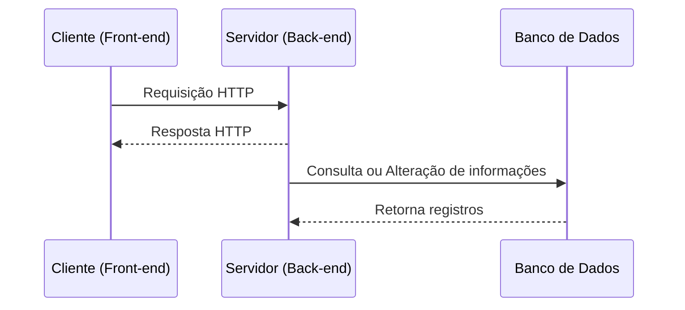
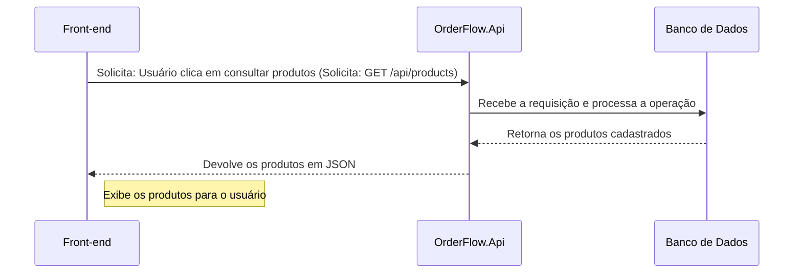

# Como funciona uma aplicação Back-end?
```Text
Objetivo: compreender a comunicação entre cliente e servidor e identificar o papel da nossa API dentro desse processo.
```

## 1. O que acontece quando você usa um site?
Ao acessar um loja virtual pelo navegador, você sabe de onde vêm dados como produtos, preços, imagens e informações visualizadas?
Uma aplicação real, normalmente, possui diferentes partes trabalhando nisso:


---
**Cliente:** É quem inicia a comunicação, solicitando alguma informação ou operação.

Pode ser:
- Um navegador, como Chrome ou Edge.
- Um aplicativo mobile.
- Outro sistema.
- Uma ferramenta de testes, como Postman.

```Text
Exemplo: um usuário acessa a página de produtos e solicita a listagem disponível.
```

---
**Servidor:** É quem recebe e processa as solicitações (aqui entra o trabalho do Back-End Developer).

Ele poderá:
- Receber uma requisição.
- Identificar o que foi solicitado.
- Validar informações.
- Executar regras de negócio.
- Consultar ou modificar dados.
- Devolver uma resposta.

> OBS: No nosso projeto, o servidor será executado utilizando ASP.NET Core.

---
**Banco de dados:** É responsável por armazenar informações de maneira persistente.

No OrderFlow, futuramente teremos informações como:
- Clientes.
- Produtos.
- Pedidos.
- Itens dos pedidos.
- Status das vendas.

> OBS: Por enquanto, ainda não temos banco de dados. Vamos adicioná-lo quando chegarmos à etapa de persistência.

## 2. Como tudo se comunica no ```cliente-servidor```?

Para consultar os produtos disponíveis no OrderFlow, o processo seria:

**1. O cliente solicita**
> O navegador envia uma requisição pedindo os produtos.

**2. O servidor recebe**
> Nossa API identifica qual operação foi solicitada.

**3. O servidor processa**
> Executa a lógica necessária e, futuramente, consulta o banco de dados.

**4. O servidor responde**
> Devolve os dados solicitados, normalmente em JSON.

**5. O cliente apresenta**
> O navegador recebe os dados e pode exibi-los ao usuário.

---
Perceba umas coisas:
- O **cliente** não precisa conhecer os detalhes internos do **servidor** ou do **banco de dados**.
- Ele precisa conhecer como ***solicitar** a operação e **interpretar** a resposta.

```Text
Trata-se de uma das características fundamentais da arquitetura cliente-servidor.
```

## 3. Onde entra uma API?
API significa _Application Programming Interface_ — Interface de Programação de Aplicações.

Pense nela como um contrato de comunicação entre sistemas. No nosso caso, a API disponibiliza operações que outros sistemas podem solicitar.

Por exemplo:

|Operação|Endpoint futuro|
|:---|:---|
|Listar produtos|	GET /api/products|
|Consultar produto|	GET /api/products/1|
|Cadastrar produto|	POST /api/products|
|Atualizar produto|	PUT /api/products/1|
|Excluir produto|	DELETE /api/products/1|

O cliente não precisa saber como o produto é armazenado ou quais classes C# são utilizadas internamente, mas sim **conhecer o contrato disponibilizado** pela API.

> Uma distinção importante: API é um conceito mais amplo. Nem toda API é uma API HTTP, e nem toda API é REST. A nossa será uma API HTTP construída com ASP.NET Core, seguindo princípios REST.

## 4. Relacionando ao [OrderFlow](Aula01.md/../../../Projetos/OrderFlow)
Imagine que futuramente teremos uma aplicação visual para administrar os pedidos.

Quando o usuário clicar em "Consultar produtos", teremos algo semelhante a:

> Por enquanto, o nosso projeto ainda não tem todas essas partes. Mas essa é a arquitetura que construiremos progressivamente.

## 5. O que foi visto nessa aula
**Principal responsabilidade do cliente em uma arquitetura cliente-servidor:**
> Iniciar solicitações ao servidor e interpretar suas respostas.

**Principal responsabilidade do Back-end:**
> Receber e processar solicitações, executar regras e lidar com dados.

**Função de uma API nesse cenário:**
> Definir uma forma de comunicação entre aplicações.

**Função do Banco de Dados nessa arquitetura:**
> Armazena e disponibiliza os dados utilizados pela aplicação.

<br>
<div align="center">

| [Voltar à pasta](Aula01.md/..) | [Próximo dia](Aula01.md/../../Dia003) |
|--------------------------------|---------------------------------------|
  
</div>
