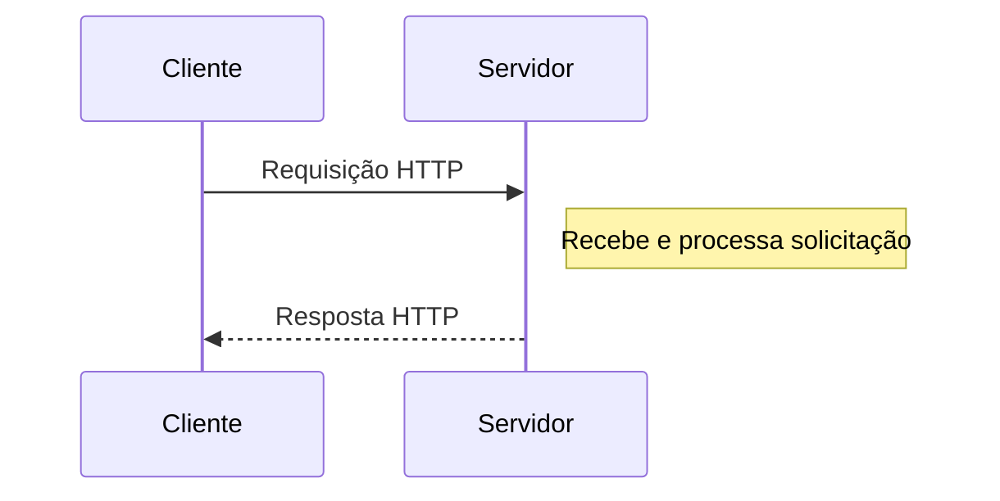

# HTTP: como funciona a comunicação entre cliente e servidor?
```Text
Objetivo: entender como essa comunicação acontece tecnicamente, utilizando o protocolo HTTP
```

## 1. O que é HTTP?
**HTTP** significa _Hypertext Transfer Protocol_ (Protocolo de Transferência de Hipertexto) e é um protocolo de comunicação que define como clientes e servidores trocam informações.

Por exemplo:
```Text
Quando você acessa uma página, consulta produtos ou finaliza um pedido, pode existir uma comunicação HTTP entre o navegador e o servidor.
```

O HTTP segue um modelo de requisição e resposta (Request-Response):


> **HTTP** não é a própria internet. É um protocolo utilizado para comunicação entre aplicações, normalmente transportado sobre **TC**P ou **QUIC**, dependendo da versão do HTTP.
> Quando utilizamos **HTTPS**, essa comunicação é protegida por criptografia **TLS**.

## 2. Anatomia de uma requisição HTTP
Imaginando que o OrderFlow já possua uma funcionalidade para consultar produtos, o cliente envia:
```HTTP
GET /api/products HTTP/1.1
Host: localhost:5000
Accept: application/json
```

---
### 2.1 Desmembrando
> **GET**
> 
> `GET /api/products HTTP/1.1`
> 
> Método HTTP, caminho e versão do protocolo.
>
> ---
>
> **Headers (cabeçalhos)**
>
> `Host: localhost:5000`
>
> `Accept: application/json`
>
> Informações adicionais sobre a requisição.
>
> ---
>
> **Body (corpo)**
>
> `Nenhum neste exemplo.`
>
> Conteúdo enviado junto à requisição, quando necessário.

---
### 2.2 Entendendo cada parte

**A. Método HTTP:** Indica qual tipo de operação o cliente deseja realizar.

Métodos comuns:
| Método | Finalidade| Exemplo|
|:---|:---|:---|
|GET	|Consultar	|Listar produtos|
|POST	|Criar ou processar	|Criar pedido|
|PUT	|Substituir/atualizar	|Atualizar produto|
|PATCH	|Atualizar parcialmente	|Alterar preço|
|DELETE	|Remover	|Excluir produto|

Cada método possui semântica própria. Por exemplo:
```Text
GET deve ser utilizado para consulta e não para realizar alterações no estado do sistema.
```

---
**B. URL (endereço do recurso):** Identifica onde o cliente deseja realizar a operação.

Exemplo:
```Text
https://localhost:7000/api/products/10
```

Separado em:
| Parte | Significado |
|:---|:---|
|`https`|	Esquema/protocolo|
|`localhost`|	Host|
|`7000`|	Porta|
|`/api/products/10`|Caminho do recurso|

> No nosso caso, estamos indicando que queremos acessar o produto de identificador 10.

---
**C. Headers (cabeçalhos):** São informações adicionais que acompanham a requisição.

Exemplos:
```HTTP
Accept: application/json
Content-Type: application/json
Authorization: Bearer token
```

Observe a diferença:
- `Accept`: informa quais formatos de resposta o cliente aceita.
- `Content-Type`: informa o formato do conteúdo enviado.
- `Authorization`: pode transportar credenciais ou um token de autenticação.

> Não é preciso decorar todos agora. O importante é entender sua finalidade.

---
**D. Body (corpo):** É onde podemos enviar os dados necessários para determinada operação.

Imagine que o cliente queira cadastrar um produto:
```HTTP
POST /api/products HTTP/1.1
Content-Type: application/json
```

Corpo da requisição:
```Json
{
  "name": "Teclado Mecânico",
  "price": 250.00,
  "stock": 15
}
```

O servidor recebe esses dados e pode utilizá-los para executar as regras de cadastro.

> Importante: nem toda requisição possui body. Uma consulta **GET**, por exemplo, normalmente não precisa dele.

## 3. Anatomia de uma resposta HTTP
Imaginando que o servidor recebeu uma requisição para cadastrar um produto e conseguiu concluir a operação. A resposta pode ser:
```HTTP
HTTP/1.1 201 Created
Content-Type: application/json
```

Corpo da resposta:
```Json
{
  "id": 10,
  "name": "Teclado Mecânico",
  "price": 250.00,
  "stock": 15
}
```

---
### 3.1 Desmembrando
> **201 Created**
> 
> `HTTP/1.1 201 Created`
> 
> Versão HTTP e código de status
>
> ---
> 
> **Headers**
>
> `Content-Type: application/json`
>
> Informações sobre a resposta
>
> ---
> 
> **Body**
>
> ```Json
> {
>   "id": 10,
>   "name": "Teclado Mecânico"
> }
> ```
>
> Dados retornados ao cliente
---

Perceba que a resposta informa duas coisas:
1. O resultado da operação: `201 Created`.
2. Os dados do recurso criado: `identificador`, `nome`, `preço` etc.

## 4. Códigos de status HTTP
Os códigos de status informam o resultado da requisição.

---
### 4.1 Divisão
|Grupo	|Significado|
|:---|:---|
|1xx	|Informações|
|2xx	|Sucesso|
|3xx	|Redirecionamento|
|4xx	|Erro relacionado à requisição do cliente|
|5xx	|Erro no servidor|

Muito utilizados:

`200` **OK** — requisição executada com sucesso.

`201` **Created**— recurso criado com sucesso.

`204` **No Content** — operação bem-sucedida, sem conteúdo na resposta.

`400` **Bad Request** — requisição inválida.

`401` **Unauthorized** — autenticação necessária ou inválida.

`403` **Forbidden** — cliente não possui permissão para acessar.

`404` **Not Found** — recurso não encontrado.

`500` **Internal Server Error** — erro inesperado no servidor.

> Importante:
>   `401` significa que a autenticação não foi aceita ou está ausente; 
>   `403` significa que o servidor entendeu a solicitação, mas não permite o acesso.

## 5. Aplicando no [OrderFlow](Aula01.md/../../../Projetos/OrderFlow)

**Situação A — Consultar produtos:** O cliente deseja visualizar todos os produtos.
```HTTP
GET /api/products
```

Resposta possível:
```HTTP
200 OK
```

---
**Situação B — Cadastrar produto:** O cliente envia os dados de um novo produto.
```HTTP
POST /api/products
```

Resposta possível:
```HTTP
201 Created
```

---
**Situação C — Consultar produto inexistente:** O cliente procura o produto de ID 999.
```HTTP
GET /api/products/999
```

Resposta possível:
```HTTP
404 Not Found
```

> Observe como o método, o caminho e o status ajudam a definir o contrato de comunicação da nossa API.

<br>
<div align="center">

| [Voltar à pasta](Aula01.md/..) | [Próximo dia](Aula01.md/../../Dia004) |
|--------------------------------|---------------------------------------|
  
</div>
